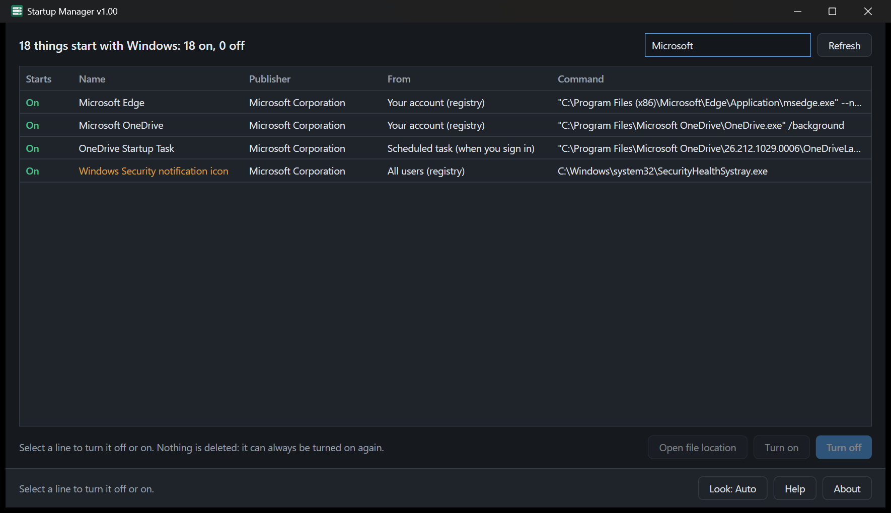

  

# Startup Manager

See what runs when Windows starts, and turn things off safely.

    

## ✨ Features

Startup Manager is a PowerShell/WPF tool that lists everything that runs when Windows starts or you sign in, and lets you turn things off, and on again, safely.

- **Everything in one list**: programs set to start for you or for all users (registry), shortcuts in the Startup folders, and scheduled tasks that run when you sign in or the PC starts (Windows' own tasks are left out). Each shows its name, publisher, where it comes from and the command it runs.
- **Turn off and Turn on**, the same way Task Manager does it: nothing is deleted or uninstalled, Windows just skips it at the next start, and it can be turned on again at any time. Items for all users and scheduled tasks ask for administrator rights first.
- **Think twice**: security software (such as your antivirus) and device drivers are shown in amber, and the app asks before turning them off. Entries whose program has gone are shown in red.
- Search, Open file location, Refresh (F5), light and dark looks, Help and an About box.

## 🖼️ Screenshots

## 📋 Requirements

- Windows 10 or 11.
- Windows PowerShell 5.1 (built into Windows) with .NET Framework 4.7.2 or later.

## 📦 Installation

1. Download `Startup-Manager-v1.00.zip` from the [latest release](../../releases/latest) and unzip it wherever you like to keep it.
2. Double-click **Startup Manager.cmd** in the unzipped folder. It makes a **Startup Manager** shortcut there and in the Start menu, and starts the tool. From then on, use the shortcut, the Start menu or a pinned taskbar button.

Nothing is installed and no Windows settings are changed. The shortcut runs the script with PowerShell's execution policy bypassed for that run only.

**From the repo:** clone it and double-click **Start Startup Manager.cmd**.

### Why no exe

Home tools used to ship as PS2EXE exes, and antivirus programs (ESET among them) kept flagging those exes as generic trojans by mistake. A plain script and a shortcut give the same one-click start without the false alarms, and you can read exactly what runs.

### Build a release

Double-click **Build.cmd** in the repo folder. It reads `build.json`, checks every script for syntax errors and that `$script:AppVersion` matches the newest `CHANGELOG.md` entry (if the version lives in a file of its own, add `"VersionFile": "src\\<file>.ps1"` to `build.json`; that file can call it `$script:<Name>Version`), runs PSScriptAnalyzer if it's installed, copies the release files into `..\Builds\Startup Manager v<version>\`, zips that folder for the GitHub release, refreshes `..\Builds\Startup Manager.lnk` (what the Home Launcher starts) and scans the result with ESET's command-line scanner if it's installed.

## 🚀 Usage

1. Start Startup Manager (the shortcut, the Start menu, or **Startup Manager.cmd**).
2. Select a line and press **Turn off** (or **Turn on** to put it back). Windows asks for administrator rights for items that apply to all users and for scheduled tasks.
3. The change takes effect the next time you sign in or restart.

## ⚙️ Configuration

**Where settings live:** `%APPDATA%\Startup Manager`, never inside the repo or a release folder.

- `settings.json`: the look.
- `Startup Manager.log`: what was turned off or on, and anything that went wrong.

Turning things off and on uses Windows' own `StartupApproved` settings (the ones Task Manager uses), so Task Manager's Startup page shows the same on and off.

## 📝 Changelog

See [CHANGELOG.md](CHANGELOG.md).

## 📄 Licence

[MIT](LICENSE). Copyright (c) 2026 Jason Rhodes.

Created by Jason Rhodes, built with Claude (Anthropic).
